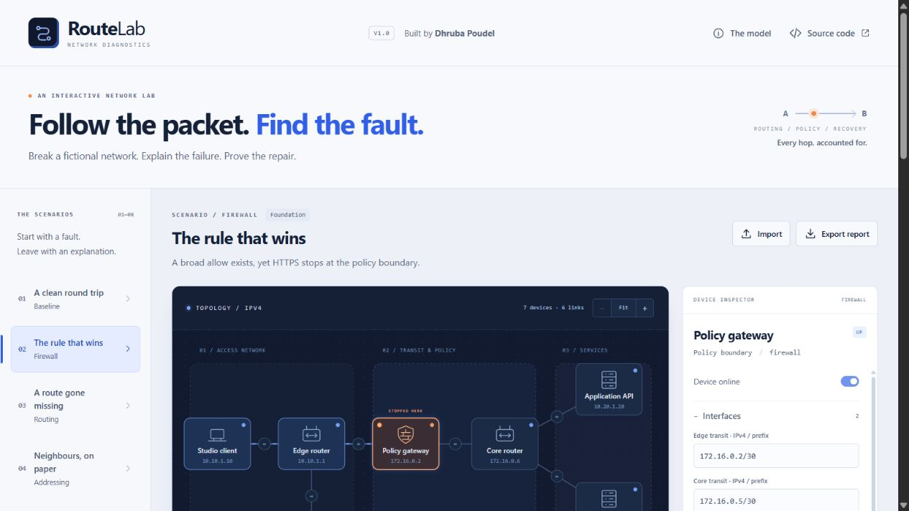

# RouteLab

**Trace a packet. Explain the failure. Prove the repair.**

RouteLab is an original, interactive IPv4 diagnostics lab by **Dhruba Poudel**. A visual topology connects editable network configuration to a deterministic forwarding engine. Visitors can follow the request and return path, inspect the rule or route behind a decision, repair a fault and replay the same test.

The application models a fictional network. It does not contact, scan or change network equipment.

[](docs/desktop-full.jpg)

## Release status

This first release is being prepared and verified. The intended public destinations are:

- Live demo: <https://about.dhrub.com.np/route-lab/>
- Public source: <https://github.com/dhrubasuz/route-lab>

Publication, exact revision and browser checks must be confirmed in [the verification record](docs/VERIFICATION.md) before these destinations are described as live.

## Explore the lab

Eight supplied scenarios introduce a healthy path and seven distinct faults:

| Scenario             | Investigation                                                       |
| -------------------- | ------------------------------------------------------------------- |
| Healthy network      | Verify both directions of a permitted service request.              |
| Blocked HTTPS        | Find the first matching firewall rule.                              |
| Missing route        | Identify the forwarding table that has no applicable route.         |
| Wrong subnet         | Explain why the configured next hop is not reachable on the link.   |
| Link down            | Locate the disabled transit connection.                             |
| Routing loop         | Follow a packet until its bounded TTL expires.                      |
| Missing return route | Distinguish reaching the service from completing the response path. |
| Service unavailable  | Separate network reachability from an enabled destination service.  |

The interface is driven by the same engine used by automated tests. Scenario outcomes are computed from configuration rather than selected from prewritten success messages.

The default network includes a workstation, edge router, policy firewall, core router, API service, database and operations workstation. The default request travels from the workstation to the API over TCP port 443.

## Engineering model

- Strict IPv4 and CIDR parsing.
- Connected and static routes, with longest-prefix selection and deterministic tie handling.
- Explicit next-hop and physical-link resolution.
- First-match stateless firewall rules, ordered by priority.
- Separate forward and response paths.
- Router TTL decrement and bounded traces.
- Immutable model operations and validated topology imports.
- Inspectable per-step reasons, route/rule identifiers and modelled transit latency.

Read [MODEL.md](docs/MODEL.md) for the supported semantics, deliberate simplifications and source references. This is a focused educational model, rather than a complete implementation of a router, TCP stack or cloud vendor's networking platform.

## Run locally

Use **Node.js 24** and **pnpm 11.25.0**, matching `package.json` and the committed lockfile.

```sh
pnpm install --frozen-lockfile
pnpm dev
```

Open <http://127.0.0.1:65463/>. The application is a static React/TypeScript build; a separate database or application server is not required.

```sh
pnpm test
pnpm typecheck
pnpm format:check
pnpm build
pnpm audit --prod
```

To inspect the built output:

```sh
pnpm preview
```

Open <http://127.0.0.1:65464/>. Vite's relative asset base supports deployment beneath the intended `/route-lab/` directory.

## Validate a change

1. Run the automated checks above against the exact source revision.
2. Verify every supplied fault through the real interface, then apply its repair and rerun the same request.
3. Inspect the complete response path, not only the first arrival at the service.
4. Edit a route or firewall rule and confirm the new trace reflects the configuration.
5. Export a report and inspect its topology, request, trace and authorship. Import a valid topology and reject malformed or oversized files with an actionable error.
6. Inspect desktop and narrow layouts, keyboard navigation, reduced motion, playback and recovery from invalid edits.
7. Record the actual deployment, test results, revision and remaining limits in [VERIFICATION.md](docs/VERIFICATION.md).

Automated tests, browser observations and deployment status are separate evidence. Test counts should be taken from the completed run, rather than copied from a planned target.

## Data and privacy

The supplied addresses, devices, services and faults are fictional. Packet traces are calculated in the browser; no real packets are generated. A topology import is a local file operation, not an upload to a diagnostics service. Static files are still requested from the hosting provider when loading the application.

Use fictional examples in public demonstrations and exported reports. A topology can describe sensitive infrastructure even when it contains no passwords. No employer configurations, customer records or private project source are included in this repository.

The initial scope makes no claim of offline installation, cross-device synchronisation, secure file storage or production network assessment. Check the interface and release record for any subsequently verified capability.

## Authorship and licence

Product design, application implementation, simulation scenarios and project documentation: **Dhruba Poudel**.

Original project code is provided under the [MIT licence](LICENSE). React, Vite and other dependencies retain their own licences. Standards and vendor documentation are referenced for their underlying concepts; no vendor affiliation or certification is implied.
